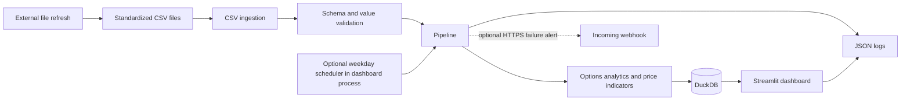

# Architecture and data model

## System overview



The pipeline is `nifty_options.pipeline.run_pipeline`. It reads and validates its inputs before opening a DuckDB transaction, writes option rows and analytics, optionally writes prices and indicators, then commits the batch. Database exceptions roll the transaction back. The command line entry point is:

```powershell
python -m nifty_options.pipeline --options-csv data/raw/options.csv --prices-csv data/raw/prices.csv
```

`--prices-csv` is optional. The scheduler is disabled by default. When enabled, it runs in the Streamlit process, on weekdays at the configured India-local time, and imports files that an external process has refreshed. It does not fetch data or apply an exchange holiday calendar. Keep DuckDB writes in one process; do not point a separate writer container at the same database while the dashboard is active.

## Module responsibilities

| Module | Responsibility |
| --- | --- |
| `ingestion/csv_files.py` | File checks and CSV parsing |
| `validation/` | Canonical columns, numeric/date validation, duplicate and OHLC checks |
| `indicators/prices.py` | SMA(20), SMA(50), and Wilder RSI(14) |
| `analytics/options.py` | Put/call OI ratio, OI-weighted max pain, IV smile, and OI by strike |
| `storage/database.py` | DuckDB schema and idempotent row replacement |
| `pipeline.py` | Transactional orchestration, recomputation, run logging |
| `reliability/http.py` | Reusable bounded HTTPS client for a future provider adapter |
| `observability.py` | JSON logs, input coverage summaries, optional HTTPS failure alert |
| `scheduler.py` | Optional weekday CSV-import scheduler |
| `dashboard/app.py` | Streamlit controls, cached database reads, charts |

## Database schema

The schema is created by `storage.database.connect` using `CREATE TABLE IF NOT EXISTS`.

| Table | Primary key | Stored values |
| --- | --- | --- |
| `prices` | `(symbol, trade_date)` | OHLCV daily bars |
| `indicators` | `(symbol, trade_date, name)` | Indicator value and calculation parameters |
| `option_chain` | `(snapshot_at, underlying, expiry, strike, option_type)` | Option-side OI, change in OI, volume, IV, prices, underlying price |
| `option_analytics` | `(snapshot_at, underlying, expiry)` | PCR, max-pain strike, underlying price |

CSV inputs use the contracts documented in the [README](../README.md#csv-input-contract). Optional numeric option columns default to zero when omitted. IV is stored in the source's units; the dashboard labels this explicitly because feeds commonly provide percent values.

## Technology choices and trade-offs

- **DuckDB:** embedded, file-based storage keeps the local MVP easy to run and back up. It fits the single-process writer design. Move to PostgreSQL if the deployment needs multiple independent writers or a shared hosted database.
- **Streamlit:** provides a Python-native dashboard with minimal frontend code. Its cache is bounded and tied to database/WAL metadata; it is not a distributed cache.
- **CSV input:** keeps the project independent of exchange/vendor credentials while the provider is undecided. It requires an external process to refresh files and gives no live-feed guarantee.
- **Docker Compose:** provides a repeatable local/self-hosted container. Public deployment still needs a selected host, TLS reverse proxy, and operational secrets configuration.

## Quality, monitoring, and known limits

Ruff, Mypy, pytest, wheel build, and Docker build run in GitHub Actions on pushes and pull requests after the repository is connected to GitHub. The local pipeline emits JSON events to stdout; Docker users can view them with `docker compose logs -f dashboard`. A webhook alert is opt-in via `ALERT_WEBHOOK_URL`. Log retention and delivery guarantees depend on external infrastructure.

Inputs are checked for required columns, parseable dates, finite numeric values, duplicate keys, positive prices/strikes, and coherent OHLC ranges. Some coverage issues are warnings, including absent daily prices or an option snapshot missing one side. The prototype does not currently check source freshness against an exchange calendar.

The performance changes are algorithmic and query-scoping improvements. No production-sized benchmark has been run, so no throughput, latency, or scaling claim is made. The test fixtures are synthetic and are for software validation only.

## Next integrations to decide

1. Select an authorized market-data provider and define its schema/auth/rate limits.
2. Select a hosting target and external log/alert receiver.
3. Collect representative data and record repeatable pipeline/dashboard benchmarks before making numeric performance claims.
